# WW2 Battle Odds: User Guide

WW2 Battle Odds is a free, unofficial battle odds calculator and dice roller for World War II strategy board games. It follows the Axis & Allies 1942 Second Edition rules. Set up the units on each side, and it tells you how likely the attack is to win. It can also roll the battle for you one round at a time.

- **Open the app:** https://jbmullican.github.io/ww2-battle-odds/
- Everything runs on your phone. There are no accounts and no server, and photos never leave your device.

> The screenshots below are from an iPhone-sized screen (393 x 852). Your colors and numbers may differ slightly, because every simulation and dice roll is random.

## Contents

1. [Install it](#1-install-it)
2. [Set up a battle](#2-set-up-a-battle)
3. [Battle options](#3-battle-options)
4. [Calculate the odds](#4-calculate-the-odds)
5. [Roll the battle round by round](#5-roll-the-battle-round-by-round)
6. [Sea battles](#6-sea-battles)
7. [Count from photo (experimental)](#7-count-from-photo-experimental)
8. [Info and ruleset](#8-info-and-ruleset)
9. [FAQ and troubleshooting](#9-faq-and-troubleshooting)
10. [Disclaimer and license](#10-disclaimer-and-license)

---

## 1. Install it

### iPhone home screen (any iPhone, free)

1. Open https://jbmullican.github.io/ww2-battle-odds/ in **Safari**.
2. Tap the **Share** button (the square with an up arrow).
3. Scroll down and tap **Add to Home Screen**, then **Add**.

The app now opens full screen from its own icon, like a regular app, and keeps working offline. If you added an older version, delete the old icon and add it again to pick up name or icon changes. The app itself updates on its own whenever you open it while online.

### TestFlight (native iPhone app, internal testers only)

The same app is also built as a native iPhone app and handed out through Apple's **TestFlight**. It's only for internal testers, meaning people on the owner's App Store Connect team, and it isn't on the App Store.

1. Install Apple's **TestFlight** app from the App Store.
2. Accept the TestFlight invite email, or open TestFlight and find **WW2 Battle Odds**.
3. Tap **Install**.

Each TestFlight build expires after 90 days. When the owner publishes a new build, TestFlight offers the update.

---

## 2. Set up a battle

Pick the battle type at the top: **Land**, **Sea**, or **Amphibious**. The **Setup** tab has an **Attacker** card and a **Defender** card.

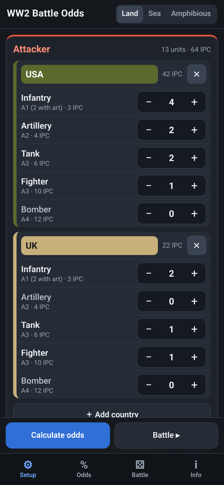

### More than one country per side

Each side can include several countries fighting together, for example the USA and the UK attacking Germany. The results keep a per-country breakdown.

- Tap **＋ Add country** under a side to add another country. It picks a likely ally first, and you can change it from the country menu.
- Tap the country name to choose a different country. A country can only appear once per side.
- Tap **✕** next to a country to remove it.
- **Clear** sets every count on that side back to zero.

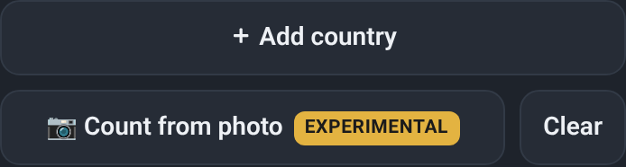

### Unit steppers

Every unit has a stepper. Tap **−** or **+**, or tap the number and type it in (0 to 99). Each row shows the unit's attack or defense value and its cost, and the country and side totals update as you go.

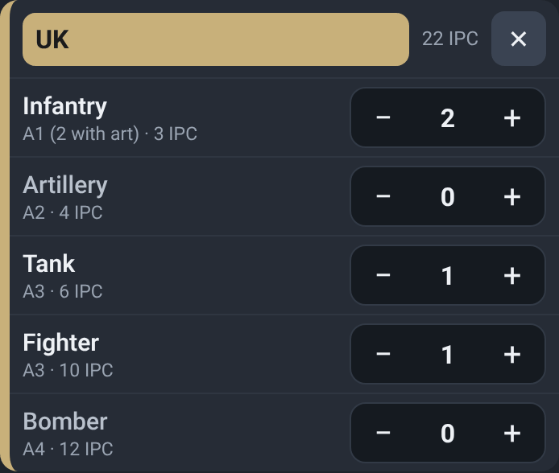

Your setup is saved on the device, so it's still there next time you open the app.

---

## 3. Battle options

The **Options** card is below the two sides on the Setup tab.

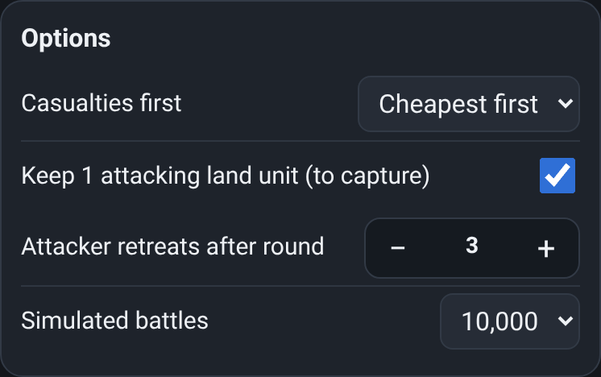

| Option | What it does |
| --- | --- |
| **Casualties first** | Which units are removed first when hits land. **Cheapest first** removes the lowest-cost units first; **Weakest first** removes the units with the lowest combat value first. Two-hit ships always take damage before anything is destroyed, and transports always go last. |
| **Keep 1 attacking land unit (to capture)** | Land and amphibious only. The attacker keeps its last land unit for as long as possible, so it can take the territory. |
| **Attacker retreats after round** | Set to a round number to make the attacker retreat after that round if the battle isn't over yet. **never** fights to the end. A retreat counts as the defender holding. |
| **Simulated battles** | How many battles to simulate: 2,000, 10,000, 25,000, or 50,000. More battles give steadier numbers but take a bit longer. 10,000 is usually plenty. |

---

## 4. Calculate the odds

Tap **Calculate odds**. The app fights the battle thousands of times on your phone, usually in under a second, and shows the results on the **Odds** tab.

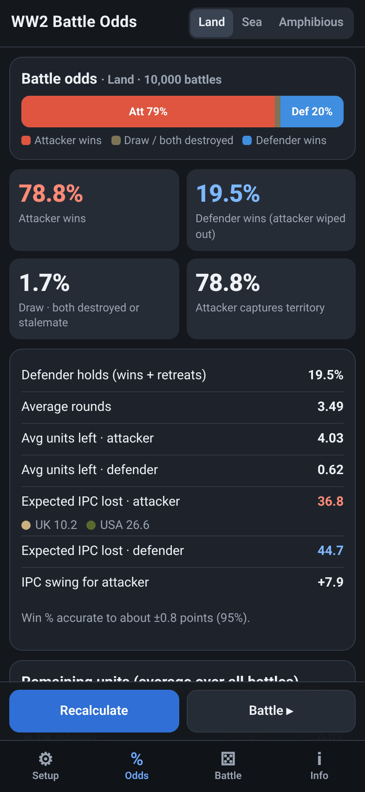

How to read it:

- **Attacker wins:** every defending unit is destroyed.
- **Defender wins:** every attacking unit is destroyed.
- **Draw:** both sides are wiped out in the same round, or neither side can hit the other (for example, aircraft against lone submarines).
- **Attacker captures territory** (land battles): the attacker wins and still has a land unit left to move in.
- **Defender holds:** defender wins plus attacker retreats.
- **Average rounds:** how many rounds the battle lasts on average.
- **Avg units left:** how many units each side has left, averaged over all the battles.
- **Expected IPC lost:** the average value of the units each side loses, with a per-country split when a side has more than one country. **IPC swing** is the defender's loss minus the attacker's. A positive number favors the attacker.
- The line at the bottom shows how precise the win percentage is (about ±1 point with 10,000 battles).

Scroll down for **Remaining units**, which shows how many of each unit survive on average:

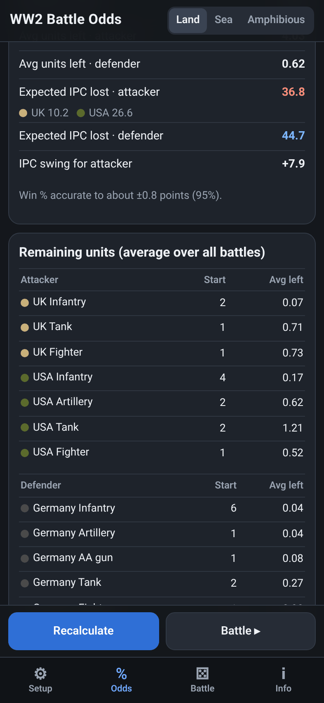

Change anything on the Setup tab and tap **Recalculate** to compare plans.

---

## 5. Roll the battle round by round

Tap **Battle ▸** to play the battle out with dice, like at the table. The buttons along the bottom are:

- **🎲 Roll**: roll one round of combat.
- **Auto**: keep rolling until the battle ends.
- **Retreat**: the attacker retreats (available after round 1).
- **Reset**: start the battle over with your setup.

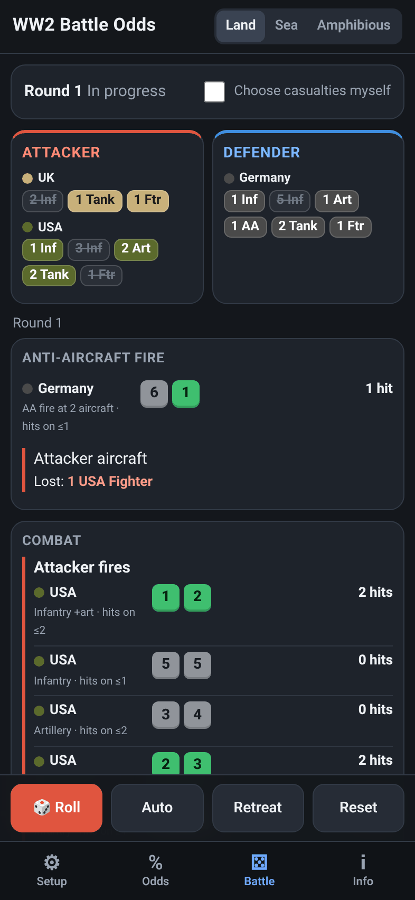

The top shows each side's forces. Struck-through chips are units that have been lost, and "dmg" marks damaged two-hit ships. Below that, every roll is listed: who fired, the dice (green dice are hits), what each unit needed to hit, and the casualties. Earlier rounds are under **Battle log**.

### Auto or choose casualties

By default the app picks casualties for you using your **Casualties first** option. Turn on **Choose casualties myself** to pick them yourself. After each roll, set how many of each unit to remove for each side, then tap **Remove casualties**. **Use suggestion** fills in the app's own choice. The app won't let you make an illegal choice, such as sinking a battleship before it's damaged.

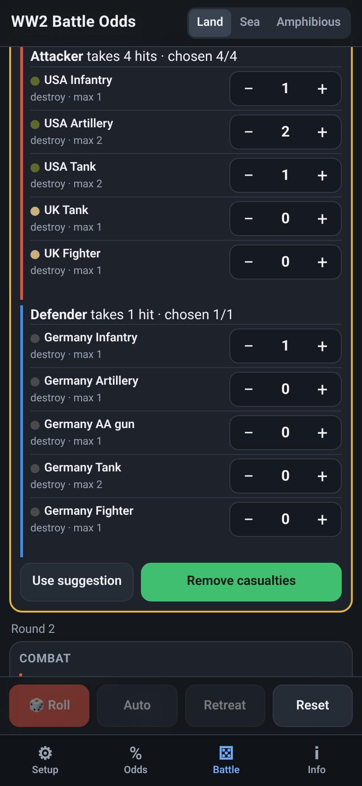

When the battle ends, a banner shows the result and the IPC each side lost:

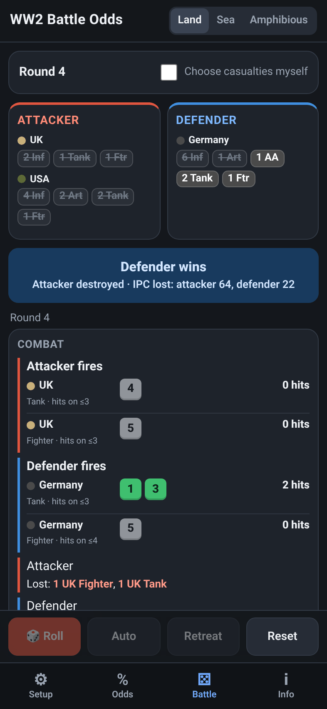

---

## 6. Sea battles

Tap **Sea** at the top. The unit list changes to naval units and aircraft. Here Japan attacks a combined USA and ANZAC fleet:

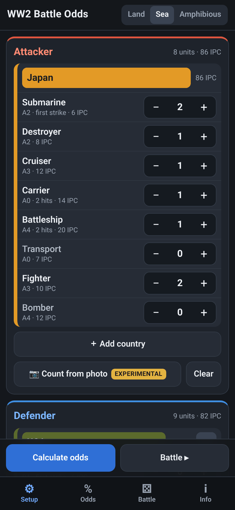

Calculate the odds or roll it out as before. Sea rules are applied automatically: submarine surprise strikes, destroyers canceling them, battleships and carriers taking two hits, aircraft unable to hit subs without a destroyer, and transports being taken last or destroyed when left alone.

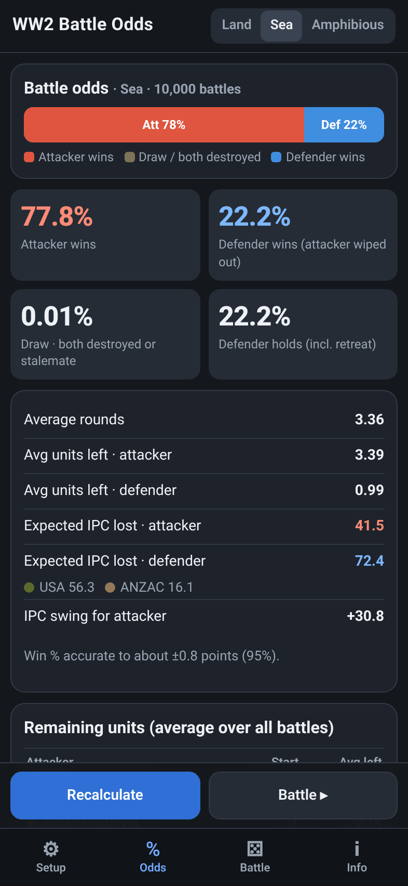

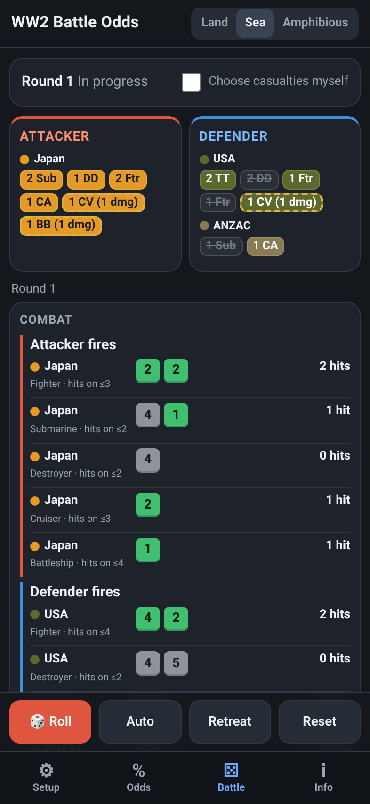

**Amphibious** works like Land, except that attacking battleships and cruisers fire one shore bombardment shot each in round 1.

---

## 7. Count from photo (experimental)

> **Experimental.** This is a rough helper, not a reliable counter. Check every number before you use it.

Tap **📷 Count from photo** on a side. You can take a photo or choose one you already have. The photo is analyzed on your phone and is never uploaded.

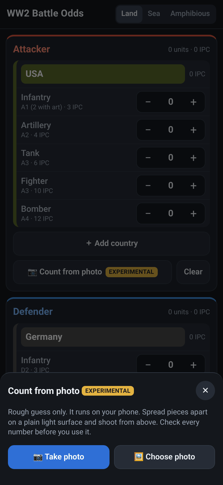

The app finds pieces that stand out from the background, groups them by plastic color into countries, and guesses each unit's type from its size only. Numbered boxes show what it found:

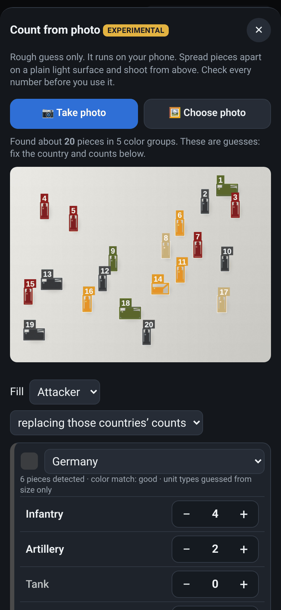

*The photo above is a computer-generated test image, not a real board.*

### Review and edit before using

Nothing changes until you confirm. For each color group you can:

- choose the right country, or **Ignore this group**,
- fix each unit count with the steppers,
- choose whether to fill the **Attacker** or the **Defender**, and whether to **replace** those countries' counts or **add** to them.

Then tap **Use these counts** and double-check the Setup tab.

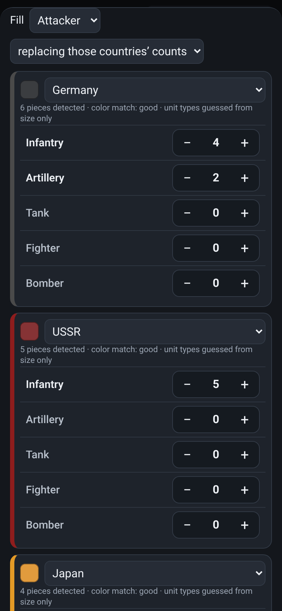

### Tips for better results

- Use a **plain, light background**, like a sheet of white paper. Board art confuses it.
- **Spread the pieces apart.** Pieces that touch are counted as one.
- Use **good, even light** and avoid strong shadows.
- Shoot **straight down from above**.
- Similar colors (for example UK, ANZAC, and Italy) are easy to mix up. Check the country for each group.
- Unit types are only a guess from size. Expect to fix some of them.

---

## 8. Info and ruleset

The **Info** tab has a quick how-to, the full unit table (attack, defense, cost, hits), the 1942 Second Edition rules the app uses, and the simplifications it makes, such as a fixed casualty order and subs never submerging.

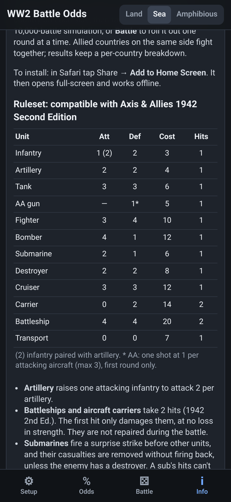

---

## 9. FAQ and troubleshooting

**The odds change a little every time I calculate.**
That's normal, because each calculation is a fresh random simulation. With 10,000 battles, expect about ±1 point. Choose 25,000 or 50,000 for steadier numbers.

**Why doesn't "Attacker wins" match "Captures territory"?**
In a land battle, the attacker can destroy every defender and still have no land unit left (for example, only aircraft survive). Then it wins but can't take the territory.

**Do the odds match a real game exactly?**
They're close. The simulation uses a fixed casualty order, and real players sometimes choose differently. See the Simplifications on the Info tab.

**Does it support the Anniversary Edition or 1940?**
The values are for 1942 Second Edition. Other editions are similar but not identical (for example, carriers differ).

**My setup disappeared.**
It's saved in the browser on that device. Private browsing, clearing website data, or using a different browser starts fresh. The home screen app and Safari can keep separate copies.

**Count from photo found the wrong number of pieces.**
Move the pieces apart on plain white paper, use even light, and shoot from above. Then fix the counts on the review screen. It's experimental.

**The photo won't open.**
Some HEIC photos can't be read. Take the photo from inside the app, or export it as JPEG first.

**The home screen icon still shows an old name or icon.**
Delete it and add it again from Safari.

**My TestFlight app stopped opening.**
TestFlight builds expire after 90 days. Install the newest build from the TestFlight app, or ask the owner to publish a new one.

**I found a bug or a security problem.**
Open an issue on GitHub for regular bugs. For security problems, follow [SECURITY.md](../SECURITY.md) and report them privately instead of opening a public issue.

---

## 10. Disclaimer and license

WW2 Battle Odds is an unofficial, free fan tool. It is not sold or monetized in any way. It is not affiliated with, sponsored by, or endorsed by Hasbro, Avalon Hill, or Wizards of the Coast. Axis & Allies is a trademark of Hasbro, Inc. and is mentioned only to describe compatibility. This project contains no game art, logos, or rulebook text.

The source code is licensed under the [GNU General Public License v3.0 or later](../LICENSE). The license covers this project's code only; no rights to any trademark are granted.
